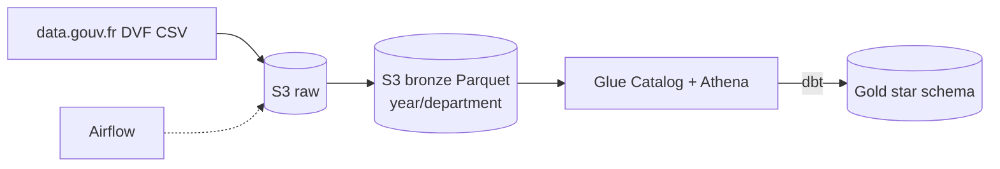

# dvf-real-estate-pipeline-aws

Data pipeline on French property transactions ([DVF open data](https://www.data.gouv.fr/fr/datasets/demandes-de-valeurs-foncieres-geolocalisees/)),
modelled as a star schema and designed for an AWS lakehouse (S3, Glue Data Catalog, Athena),
with dbt, Terraform and GitHub Actions.

> **Status: work in progress (Milestone 1 of 6).** The ingestion, the star-schema models and
> the CI exist and run locally on DuckDB. **Nothing is deployed on AWS yet**, and the
> pipeline has not yet been run on the full real dataset. See the roadmap below.

## Architecture



Details and per-component status: [docs/architecture.md](docs/architecture.md).
Why this dataset: [ADR 0001](docs/decisions/0001-dataset-and-stack.md).

## Data model

`fact_sale` (grain: one sale) with `dim_date`, `dim_commune`, `dim_property_type`.
Business rules (only sales, positive price, price not duplicated across lines, built area
from houses and apartments only) are in `dbt/models/marts/fact_sale.sql` and covered by dbt tests.

## Quick start (local, no AWS needed)

```bash
python -m venv .venv && source .venv/bin/activate
make install
make test        # unit tests
make dbt-build   # bronze from a tiny synthetic fixture, then dbt models + 16 data tests
```

Run on real data (one department, one year):

```bash
dvf download --year 2024 --department 34
dvf bronze --input data/raw/dvf_2024_34.csv.gz --year 2024 --department 34
cd dbt && dbt build --profiles-dir .
```

The download URL pattern is built from the data.gouv.fr file layout; it has not been
exercised in CI (CI uses the synthetic fixture in `tests/fixtures/`, which is not real data).

## Roadmap

| # | Milestone | State |
|---|---|---|
| 1 | Local ingestion, bronze Parquet, dbt star schema, tests, CI | Done (on fixture) |
| 2 | Run on real DVF for one department, data-quality profiling, first analysis queries | Next |
| 3 | AWS: apply Terraform, upload bronze to S3, Glue catalog, Athena queries | Planned |
| 4 | dbt on Athena (`dbt-athena`), incremental models | Planned |
| 5 | Airflow orchestration (local Docker first) | Planned |
| 6 | Cost report, docs, optional Spark/Glue job comparison | Planned |

## Cost control

Terraform sets an Athena per-query scan cap (1 GiB) and a monthly budget alert. Terraform has
**not** been applied; deploying is a manual step (see [terraform/README.md](terraform/README.md)).

## Layout

```
src/dvf_pipeline/   download + CSV -> Parquet
dbt/                staging + marts (DuckDB profile)
terraform/          S3, Glue database, Athena workgroup, budget
tests/              pytest + synthetic fixture
.github/workflows/  CI
```

## License

MIT. DVF data: open licence (Etalab), see the dataset page.
