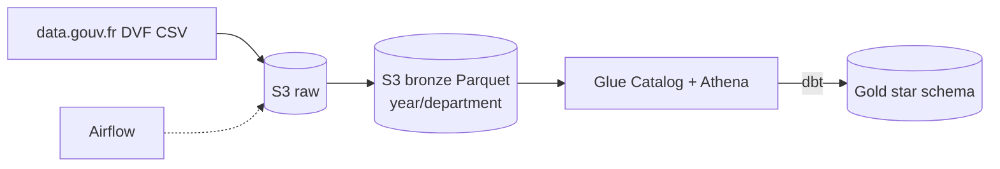

# dvf-real-estate-pipeline-aws

Data pipeline on French property transactions ([DVF open data](https://www.data.gouv.fr/fr/datasets/demandes-de-valeurs-foncieres-geolocalisees/)),
modelled as a star schema and designed for an AWS lakehouse (S3, Glue Data Catalog, Athena),
with dbt, Terraform and GitHub Actions.

> **Status: work in progress (Milestone 2 of 6).** The ingestion, the star-schema models and
> the CI run locally on DuckDB. The pipeline has been run on real data for one department
> and one year (Herault, 2024), not on the full dataset. **Nothing is deployed on AWS yet.**
> See the roadmap below.

## Goal

Turn the raw, messy French property transaction file (DVF) into a clean, tested, queryable
dataset, using the same building blocks as a production data platform on AWS. The questions
the final model is meant to answer with plain SQL:

- What is the median price per m² by commune, property type (house or apartment) and year?
- How many sales happen per commune and per month?
- Which sales are atypical (mixed use, several communes, implausible price) and should be
  excluded from price analyses?

The project is also a learning exercise: its purpose is to practise lakehouse layering,
data modelling, data-quality testing, infrastructure as code and CI on real, imperfect data.

### Pipeline steps

| # | Step | What it does | Local (today) | On AWS (planned) |
|---|---|---|---|---|
| 1 | Ingestion | Download the official DVF CSV from data.gouv.fr, one file per department and year | `dvf download` | Same script, files land in S3 `raw/` |
| 2 | Storage | Convert to Parquet, partitioned by year and department (bronze layer) | `dvf bronze` to local Parquet | S3 `bronze/`, registered in the Glue Data Catalog |
| 3 | Transformation | Type the columns and clean them with dbt: deduplicated dwellings and land, prices as `decimal(14,2)`, flags for mixed-use, multi-commune and price-outlier sales, plus data-quality tests | dbt on DuckDB | dbt on Athena |
| 4 | Modelling and querying | Star schema: `fact_sale` with `dim_date`, `dim_commune`, `dim_property_type`, queried in SQL | DuckDB | Athena over S3 `gold/` |
| 5 | Orchestration | Run the steps on a schedule | Manual commands | Airflow (later) |

## Architecture



Details and per-component status: [docs/architecture.md](docs/architecture.md).
Why this dataset: [ADR 0001](docs/decisions/0001-dataset-and-stack.md).

## Data model

`fact_sale` (grain: one sale) with `dim_date`, `dim_commune`, `dim_property_type`.
Business rules (only sales, positive price, price not duplicated across lines, built area
from houses and apartments only, surfaces deduplicated) are in
`dbt/models/marts/fact_sale.sql`, with dbt tests on the main ones.

## Quick start (local, no AWS needed)

```bash
python -m venv .venv && source .venv/bin/activate
make install
make test        # unit tests
make dbt-build   # bronze from a tiny synthetic fixture, then dbt models + data tests
```

Run on real data (one department, one year):

```bash
dvf download --year 2024 --department 34
dvf bronze --input data/raw/dvf_2024_34.csv.gz --year 2024 --department 34
cd dbt && dbt build --profiles-dir .
```

The download is not exercised in CI (CI uses the synthetic fixture in `tests/fixtures/`,
which is not real data). It was run manually for Herault, 2024.

## Findings on real data (Herault, 2024)

Volumes of the downloaded file (they can change when the source is republished):

| Stage | Count |
|---|---|
| Raw lines | 69,651 |
| Distinct mutations | 29,565 |
| Eligible lines (`Vente`, positive price) | 60,775 |
| Sales in `fact_sale` | 26,652 |

**Exclusions.** Only `nature_mutation = 'Vente'` is kept. This leaves out, counted as
mutations before any price filter: off-plan sales (VEFA, 2,421), building land sales
(`Vente terrain à bâtir`, 182), exchanges (180) and auctions (89). Results therefore do not
describe the off-plan market.

**Defects found and how they are handled:**

| Finding | Handling |
|---|---|
| A dwelling can be repeated for each land use (`nature de culture`) of its parcel, which inflates built area | Dwelling units are deduplicated before summing |
| Land area is repeated across lines | Deduplicated separately, per parcel, disposition, land use and area |
| The price-total test compared floating-point sums with strict equality and failed | Prices are `decimal(14,2)` |
| Some sales mix dwellings and commercial premises, so the whole price lands on the dwelling area | Flagged `is_mixed_use` (361 sales) |
| Some sales span several communes | Flagged `is_multi_commune` (105); the commune with the largest dwelling area is kept (ties: lowest code) |
| Implausible prices per m² (such as 1 EUR sales or 1 m² dwellings) | Flagged `is_price_outlier` (194): below 300 or above 30,000 EUR/m², or built area under 9 m² |

636 sales carry at least one flag. They stay in `fact_sale`; price-per-m² analyses should
exclude them.

**Limits.** One department and one year only. Surface deduplication and outlier thresholds
are heuristics (DVF has no unique dwelling identifier): distinct units or sub-parcels with
identical attributes could still be merged, and repeated lines could still be counted twice.
Results have not been validated against an external reference. Sales that mix houses and
apartments are not flagged: their price per m² blends both.

## Roadmap

| # | Milestone | State |
|---|---|---|
| 1 | Local ingestion, bronze Parquet, dbt star schema, tests, CI | Done (on fixture) |
| 2 | Run on real DVF for one department, data-quality profiling and fixes | Done on one department-year (heuristic dedup and outlier rules, no external validation) |
| 3 | AWS: apply Terraform, upload bronze to S3, Glue catalog, Athena queries | Next |
| 4 | dbt on Athena (`dbt-athena`), incremental models | Planned |
| 5 | Airflow orchestration (local Docker first) | Planned |
| 6 | Cost report, docs, optional Spark/Glue job comparison | Planned |

## Cost control

Terraform sets an Athena per-query scan cap (1 GiB) and a monthly budget alert. Terraform has
**not** been applied; deploying is a manual step (see [terraform/README.md](terraform/README.md)).

## Layout

```
src/dvf_pipeline/   download + CSV -> Parquet
dbt/                staging + marts (DuckDB profile)
terraform/          S3, Glue database, Athena workgroup, budget
tests/              pytest + synthetic fixture
.github/workflows/  CI
```

## License

MIT. DVF data: open licence (Etalab), see the dataset page.
