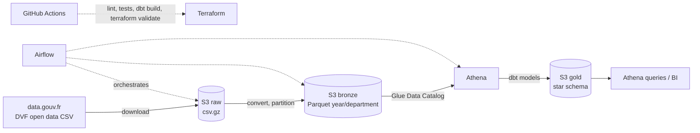
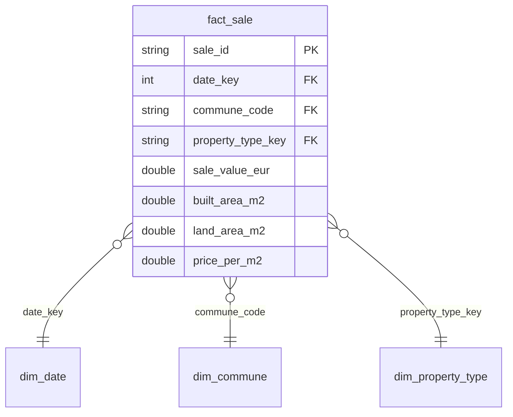

# Architecture

## Status of each box

| Component | Status |
|---|---|
| Download + CSV -> Parquet (bronze), local | Done (Milestone 1) |
| dbt star schema on DuckDB | Done on a synthetic fixture (Milestone 1) |
| CI (lint, tests, dbt, terraform validate) | Done (Milestone 1) |
| Terraform for S3 / Glue / Athena / budget | Written, **not applied** |
| Glue Crawler / catalog, Athena queries | Planned (Milestone 3) |
| dbt on Athena | Planned (Milestone 4) |
| Airflow orchestration | Planned (Milestone 5) |

## Star schema

Grain of `fact_sale`: one row per sale (`id_mutation`). DVF repeats the total price on every
line of a sale, so lines are aggregated first. A naive sum over lines would multiply the
price by the number of lines; a dbt test (`assert_sale_total_not_duplicated`) guards that.
